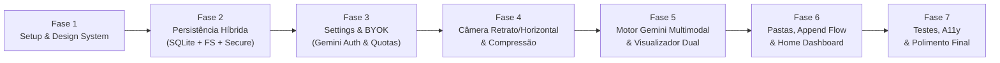

# AnotaAI — Roadmap de Implementação & Estratégia de Testes

Este documento organiza o desenvolvimento do **AnotaAI** em **7 Fases (Milestones)** sequenciais e incrementais, permitindo validar cada camada antes de avançar para a próxima.

---

## 🗺️ Visão Geral das Fases

---

## 📦 Detalhamento das Fases de Desenvolvimento

---

### Fase 1: Fundação do Projeto & Design System (Obsidian Note Engine)
* **Objetivo:** Inicializar o projeto Flutter, configurar dependências no `pubspec.yaml`, importar o logo SVG do Stitch e codificar o tema completo.
* **Entregáveis:**
  1. `pubspec.yaml` configurado com `provider`, `sqflite`, `path_provider`, `flutter_secure_storage`, `camera`, `image_picker`, `flutter_image_compress`, `http`, `flutter_markdown`, `flutter_math_fork`, `google_fonts`, `share_plus`.
  2. `lib/core/constants/app_colors.dart` e `app_dimens.dart`.
  3. `lib/core/theme/app_theme.dart` com `Space Grotesk` e `JetBrains Mono`.
  4. Widgets globais base: `ObsidianTopBar`, `FloatingBottomNav`, `TactileScaleWrapper` e `PastelFlashcard`.
  5. Navegação base (Shell de abas `Home`, `Folders`, `Settings` e rota modal para `Scanner`).
* **Critério de Pronto (DoD):** `flutter analyze` sem avisos; navegação entre os esqueletos das abas funcionando a 60fps com a identidade visual exata do Stitch.

---

### Fase 2: Camada de Dados Local Híbrida (SQLite + Arquivos `.md`/`.jpg` + Keystore)
* **Objetivo:** Construir toda a persistência local e semear as 5 pastas iniciais do Google Stitch.
* **Entregáveis:**
  1. `LocalDbDatasource`: Criação do banco `anota_ai.db` com as tabelas `folders`, `notes`, `note_images`, `action_items` e `api_usage_logs`.
  2. **Database Seed:** Inserção automática das 5 pastas padrão (*Personal notes*, *Work & sprints*, *Whiteboard snaps*, *Lecture transcriptions*, *Research papers*) na primeira execução.
  3. `FileStorageDatasource`: Leitura, criação, append, sincronização de checkboxes (`- [ ]` $\leftrightarrow$ `- [x]`) e exclusão limpa de arquivos `.md` e imagens `.jpg`.
  4. `SecureStorageDatasource`: Leitura/escrita criptografada das chaves de API por provedor.
  5. `NotesRepositoryImpl` e `SettingsRepositoryImpl`.
* **Critério de Pronto (DoD):** Testes unitários validando criação de nota, salvamento de `.md` físico, vínculo de múltiplas imagens e atualização de checkboxes.

---

### Fase 3: Módulo de Configurações, BYOK & Monitoramento de Quota
* **Objetivo:** Permitir que o usuário configure sua chave do Gemini, teste a latência real e visualize seu consumo.
* **Entregáveis:**
  1. `SettingsProvider` (`ChangeNotifier`).
  2. Tela `SettingsScreen` com seletor de provedores (Gemini ativo + UI para OpenAI, Anthropic e Custom).
  3. Input seguro da API Key com toggle de visibilidade e customização de Base URL.
  4. Funcionalidade **"Verify & Save Credentials"** batendo na API do Gemini e exibindo `Latency: XXms` + badge `Ready`.
  5. Widget `QuotaCircularGauge` (% consumido de 1.500 req/dia, reset 00:00 UTC) e gráfico de barras `WeeklyUsageHistoryChart` (últimos 7 dias).
* **Critério de Pronto (DoD):** Usuário consegue salvar uma chave real do Google AI Studio, validar a latência e ver os gráficos atualizados.

---

### Fase 4: Módulo de Câmera (Retrato & Horizontal), Batch Mode & Compressão
* **Objetivo:** Implementar a experiência de captura fotográfica responsiva às duas orientações e o modal pós-captura.
* **Entregáveis:**
  1. `ImageProcessingService`: Compressão local para JPEG (máx. 1920px, qualidade 80%).
  2. `ScannerProvider`: Controle de câmera, flash, grade (`4x4` / `3x3`), filtro de alto contraste/de-glare e fila de fotos do modo `Batch (1/5)`.
  3. `CameraScannerScreen`:
     - Layout **Retrato (3:4)** com `ScannerReticleOverlay` e deck inferior.
     - Layout **Horizontal (Widescreen)** com `CameraControlsDock` lateral direito ergonômico e botão `Portrait`.
  4. Importação de 1 a 5 fotos via Galeria (`image_picker`).
  5. `SaveDestinationModal`: Bottom sheet pós-disparo com miniatura, `Retake`, `Create New Note` e `Add to Existing Note`.
* **Critério de Pronto (DoD):** Captura de fotos tanto na vertical quanto na horizontal funcionando com compressão abaixo de 500ms e abertura imediata do modal de destino.

---

### Fase 5: Motor Multimodal Gemini & Visualizador de Nota (`Transcribed Markdown Note`)
* **Objetivo:** Conectar o disparo de criação de nota à API do Gemini 2.5 Flash com saída estruturada e exibir a nota completa.
* **Entregáveis:**
  1. `GeminiVisionProvider` implementando `AiVisionProvider` com JSON Schema estrito (`transcribeNewNote` e `transcribeForAppend`).
  2. Auto-classificação automática da nota em uma das pastas do usuário.
  3. Tela `NoteViewerScreen` (`Transcribed Markdown Note`):
     - Seletor segmentado: **Synthesized Markdown** vs. **Original Scan**.
     - Card Hero Pastel com título, resumo e bandeja expansível (*Tokens parsed*, *Formulas: LaTeX*).
     - Callout Box **Key Takeaway**.
     - Renderização de Markdown, blocos de fórmulas matemáticas **LaTeX** (`FormulaCalloutCard`) e diagramas.
     - Lista interativa de **Detected Action Items** sincronizada com o SQLite e com o arquivo `.md`.
     - Aba **Original Scan** com carrossel de imagens de alta resolução e zoom (`InteractiveViewer`).
     - Botões utilitários **Copy** (com toast) e **.md** (exportação/compartilhamento).
     - Modo de edição inline para ajustes manuais no texto/título.
* **Critério de Pronto (DoD):** Tirar foto de uma equação ou quadro, processar no Gemini 2.5 Flash e visualizar a nota renderizada com LaTeX e checkboxes funcionais.

---

### Fase 6: Gestão de Pastas, Fluxo de Append (`Select Destination Note`) & Home Dashboard
* **Objetivo:** Completar os fluxos de anexação a notas existentes, organização de pastas e métricas em tempo real na Home.
* **Entregáveis:**
  1. `SelectDestinationScreen`: Banner de scan pendente, busca instantânea, filtros rápidos, árvore de pastas em acordeão e botão *"Append Transcription"* com indicador de nota alvo.
  2. `FoldersScreen`: Listagem das pastas com ícones e cores do Stitch, filtros por categoria, criação de novas pastas via FAB (`+`) e visualização das notas de cada pasta.
  3. `DashboardScreen`: Saudação dinâmica, card tátil *"Scan your note"*, gráfico semanal `WeeklyActivityChart` alimentado pelo banco local (`Pages Converted`) e lista `RecentScansList`.
* **Critério de Pronto (DoD):** Fluxo de Append mesclando perfeitamente uma nova foto ao final de uma nota existente e Dashboard refletindo todas as contagens reais do SQLite.

---

### Fase 7: Testes Automatizados, Acessibilidade (A11y) & Polimento Final
* **Objetivo:** Garantir estabilidade em produção, cobertura de testes e revisão de acessibilidade.
* **Entregáveis:**
  1. **Testes Unitários (`test/unit/`):** Parser do JSON do Gemini, `NotesRepository`, regras de cálculo de quota UTC e sincronização de checkboxes em Markdown.
  2. **Testes de Widgets (`test/widget/`):** Renderização do `DashboardScreen`, alternância de abas no `NoteViewerScreen`, interação do `SelectDestinationScreen` e estados de erro de API.
  3. **Auditoria de Acessibilidade:** Semântica de botões (`Semantics` / `tooltip`), contraste nos cards pastéis e áreas mínimas de toque (`48x48dp`).
* **Critério de Pronto (DoD):** 100% dos testes passando (`flutter test`) e zero warnings no `dart analyze`.
