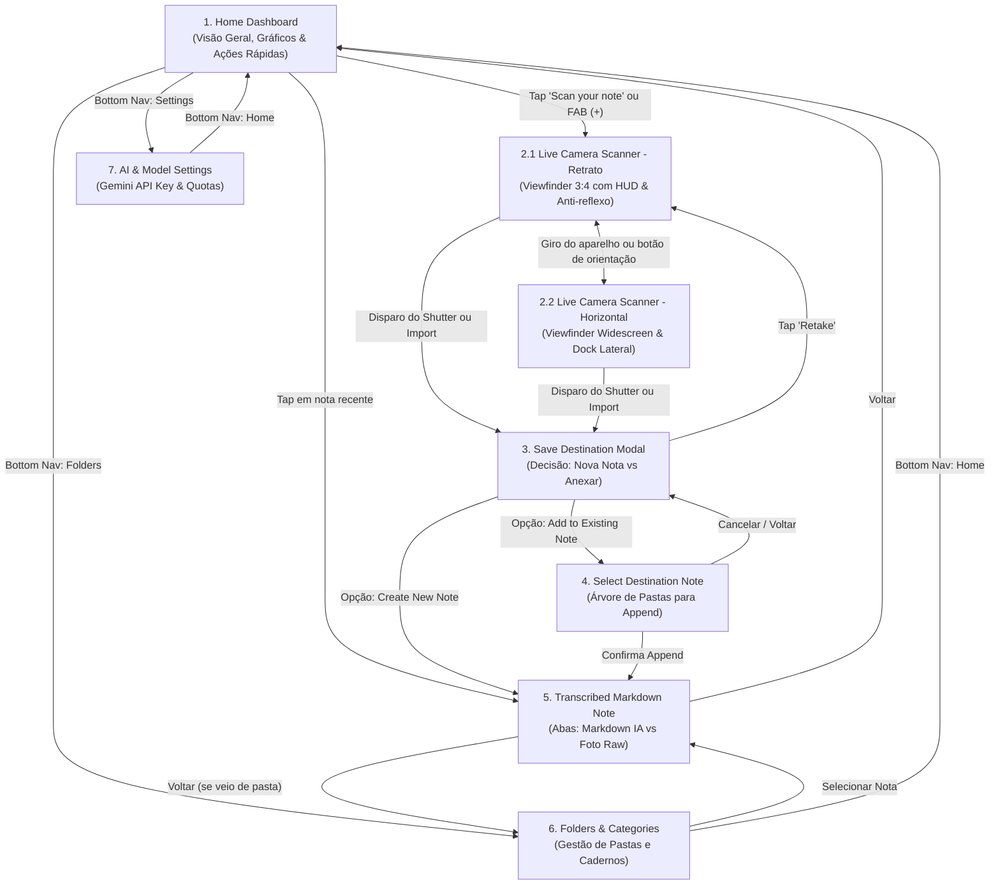

# AnotaAI — Mapeamento Detalhado de Telas e Fluxos (Google Stitch)

Este documento descreve detalhadamente cada uma das telas projetadas no **Google Stitch** para o aplicativo **AnotaAI**, especificando os elementos visuais, a funcionalidade principal de cada interface e as relações de navegação entre elas.

---

## 🗺️ Mapa Geral de Navegação e Relações

---

## 📱 Especificação das Telas

---

### 1. Home Dashboard
* **ID no Stitch:** `f528dc95448f4167b0465b8d6a19891b`
* **Tipo de Shell:** `mobile_tab`
* **Funcionalidade Principal:** Ponto de entrada do usuário. Oferece uma visão panorâmica das digitalizações diárias e semanais, atalho imediato para o scanner e acesso às notas mais recentes.

#### Elementos Presentes
1. **Top App Bar:**
   - Cápsula central translúcida estilo "Dynamic Island" com indicador de pulso e ícone `auto_awesome`.
   - Logotipo oficial do AnotaAI (`AnotaAI Spark Logo`).
   - Título tipográfico *"Home Dashboard"* em *Space Grotesk*.
2. **Banner de Boas-Vindas (Hero Card em Azul Névoa `#BCE3EC`):**
   - Saudação em tipografia destacada (*"Good morning!"*).
   - Metadados do dia (*"4 notes digitized today"*).
   - Textura sutil decorativa de papel milimetrado em filigrana no canto inferior direito.
3. **Seção "Quick Actions" (Ação Tátil Primária):**
   - Cabeçalho de seção com tag monospaçada *"Tactile Mode"*.
   - Cartão tátil grande em Amarelo Manteiga (`#F3F7A2`) com ícone de câmera, título *"Scan your note"* e legenda *"Whiteboard or index card"*.
4. **Gráfico de Atividade Semanal (Weekly Activity & OCR Volume):**
   - Contador de meta destacada (*"42/50 pages digitized"*).
   - Badge com luz indicadora pulsante *"Live"*.
   - Gráfico de 7 colunas verticais (dias da semana: M, T, W, T, F, S, S) com o dia atual em destaque amarelo e dias anteriores em tons de lavanda (`#D6C7FB`).
5. **Lista de Scans Recentes (Recent Scans):**
   - Botão *"View all"* com chevron.
   - Cards de notas com ícones em discos coloridos (ex: algoritmo, diagrama de arquitetura, post-its de sprint retro).
   - Tags de formato gerado (`Markdown`, `Mermaid JS`, `Bulleted list`).
   - Tempo relativo (*"2m ago"*, *"1h ago"*) e acurácia do processamento (*"98%"*, *"Processed"*).
6. **Bottom Navigation Deck:**
   - Barra inferior com efeito vidro escuro (`backdrop-blur-2xl`).
   - 4 destinos: **Home** (ativo), **Folders**, **Botão Flutuante Central de Captura Rápida (`+`)** e **Settings**.

#### Relações de Navegação
- **$\rightarrow$ Live Camera Scanner:** Ao tocar no card *"Scan your note"* ou no botão central flutuante `+`.
- **$\rightarrow$ Transcribed Markdown Note:** Ao tocar em qualquer item da lista de notas recentes.
- **$\rightarrow$ Folders & Categories:** Ao tocar na aba *"Folders"*.
- **$\rightarrow$ AI & Model Settings:** Ao tocar na aba *"Settings"*.

---

### 2.1 Live Camera Scanner (Modo Retrato / Portrait)
* **ID no Stitch:** `4814bc90fa8d49428771a05d9e4cb04f`
* **Tipo de Shell:** `mobile_stack`
* **Funcionalidade Principal:** Interface de captura fotográfica vertical em tempo real (proporção 3:4) para enquadramento de anotações em folhas de papel A4, cadernos verticais e post-its individuais, com HUD inteligente de cantos e filtros anti-reflexo.

#### Elementos Presentes
1. **Header da Câmera:**
   - Botão circular de retorno (`arrow_back_ios_new`).
   - Logo e título *"Photo Capture"*.
2. **Viewfinder da Câmera (Proporção 3:4):**
   - Feed de vídeo da câmera traseira em orientação vertical.
   - Vinheta degradê superior e inferior para realçar contraste dos controles sobrepostos.
   - **HUD Inteligente de Detecção de Bordas:** Caixa delimitadora (`detection-box`) com cantos luminosos em tom amarelo (`border-primary-container`), mira central em cruz e efeito de rastreamento de folhas/quadros.
3. **Controles Sobrepostos no Canvas (HUD Superior Direito):**
   - **Flashlight Toggle:** Alterna a lanterna do aparelho (`flash_off` / `flash_on`).
   - **Auto-Enhance / De-glare (`auto_fix_high`):** Filtro digital em tempo real para eliminação de reflexos de lâmpadas em quadros brancos.
   - **Composition Grid (`grid_4x4`):** Grade de linhas para alinhamento ortogonal da anotação.
4. **Deck Inferior de Disparo:**
   - **Importação da Galeria:** Botão à esquerda com miniatura polaroid e badge `+` para carregar fotos da galeria.
   - **Shutter Principal:** Botão de captura grande (96px) com borda concêntrica externa pulsante, miolo amarelo manteiga, efeito haptic e flash luminoso na tela ao bater a foto.
   - **Alternador Single / Batch:** Botão à direita que alterna o modo entre captura de página única e sequência de múltiplas páginas (*"Batch (1/5)"*).

#### Relações de Navegação
- **$\leftrightarrow$ Live Camera Scanner - Horizontal:** Ao girar o aparelho 90 graus na horizontal ou acionar o botão de rotação.
- **$\rightarrow$ Home Dashboard:** Ao tocar no botão de voltar.
- **$\rightarrow$ Save Destination Modal:** Disparado automaticamente assim que a foto é capturada ou selecionada da galeria.

---

### 2.2 Live Camera Scanner - Horizontal (Modo Paisagem / Landscape)
* **ID no Stitch:** `ce87f21f9b264234bd3a586ed02132a6`
* **Tipo de Shell:** `mobile_stack` (Otimizado para Widescreen / Landscape)
* **Funcionalidade Principal:** Interface de captura fotográfica panorâmica projetada para quadros brancos compridos (*panoramic whiteboards*), lousas de sala de aula e folhas duplas abertas. Adota um layout widescreen com **dock lateral ergonômico**, permitindo disparar confortavelmente com o polegar direito enquanto se segura o celular firmemente com as duas mãos.

#### Elementos Presentes
1. **TopBar Compacta Superior:**
   - Botão voltar (`arrow_back_ios_new`) com acabamento translúcido.
   - Ícone estilizado em badge escuro com símbolo `document_scanner`.
   - Título tipográfico *"Photo Capture"*.
   - **Botão de Alternância de Orientação:** Atalho para forçar o retorno à orientação vertical (`stay_current_portrait` com rótulo *"Portrait"*).
2. **Viewfinder Panorâmico Widescreen (Área Central):**
   - Janela de visualização ampla com cantos arredondados (`rounded-2xl`), borda fina e sombra interna (`shadow-inner-viewfinder`).
   - **Malha Pontilhada de Referência:** Fundo em gradiente radial pontilhado com passo de 24px em tom amarelo sutil (`bg-[radial-gradient(#f3f7a2_1px,transparent_1px)]`).
   - **Grade Fotográfica 3x3:** Linhas guias ortogonais suaves para alinhamento da linha do horizonte da lousa.
   - **Retículo de Detecção de Lousa Panorâmica:** Bounding box tracejada (`border-dashed border-accent-yellow/30`) com quatro cantos angulares espessos em Amarelo Fluorescente dotados de brilho neon (`shadow-glow-bracket`, `border-accent-yellow`).
   - **Mira Central em Cruz:** Crosshair de precisão (`center-crosshair`) com linhas de 5px em cruz amarela fluorescente.
3. **Barra Flutuante de Ferramentas no Viewfinder (Canto Superior Direito da Lente):**
   - **Flash Toggle:** Botão circular translúcido com ícone `flash_off`.
   - **Grid 3x3 Toggle (Ativo):** Botão circular com borda e ícone em Amarelo Manteiga brilhante (`grid_on`).
   - **Modo Alto Contraste para Anotações:** Botão `filter_b_and_w` para realçar contraste entre giz/tinta e o fundo da lousa em ambientes de iluminação desfavorável.
4. **Dock Lateral Direito de Controles Ergonômicos (`CameraControlsDock`):**
   - Barra vertical dedicada à direita (`aside`), projetada para alcance tátil do polegar direito:
   - **Topo do Dock (Mode Toggle):** Botão quadrado arredondado com ícone `filter_none` e etiqueta monospaçada *"SINGLE"* (permite alternar para *"BATCH"*).
   - **Centro do Dock (Obturador Principal):** Shutter circular grande com anel externo pulsante (`border-accent-yellow/20`), centro preenchido em Amarelo Manteiga (`bg-accent-yellow`), ícone `photo_camera`, efeito de escala suave ao toque (`active:scale-90`), sombra expansiva `shadow-glow-yellow` e etiqueta monospaçada *"CAPTURE"*.
   - **Base do Dock (Galeria / Import):** Botão quadrado para importar imagens existentes, com miniatura em degradê, ícone `image`, badge circular de adição em azul ciano (`+`) e etiqueta monospaçada *"IMPORT"*.

#### Relações de Navegação
- **$\leftrightarrow$ Live Camera Scanner - Retrato:** Ao girar o celular para a posição vertical ou tocar no botão *"Portrait"*.
- **$\rightarrow$ Home Dashboard:** Ao tocar no botão de voltar da TopBar.
- **$\rightarrow$ Save Destination Modal:** Disparado automaticamente após o clique no obturador ou importação da galeria, adaptando o modal para o contexto da captura horizontal.

---

### 3. Camera Capture - Save Note Destination (Modal)
* **ID no Stitch:** `102d03f26bf645ddae7f0704f9049155`
* **Tipo de Shell:** Modal Bottom Sheet sobreposto ao Scanner
* **Funcionalidade Principal:** Ponto de triagem imediato pós-captura. Permite ao usuário decidir se o conteúdo transcrito gerará uma nota inédita ou se será adicionado a uma anotação em andamento.

#### Elementos Presentes
1. **Backdrop & Drag Handle:** Fundo escurecido translúcido (`backdrop-blur-sm`) e barra tátil de arraste.
2. **Cabeçalho de Confirmação:**
   - Miniatura da foto capturada com check mark verde/amarelo.
   - Título *"Photo Captured"* e badge *"Ready"*.
   - Texto de orientação: *"Choose where to transcribe and store your scan"*.
   - Botão fechar (`close`).
3. **Opção A — "Create New Note" (Recomendado):**
   - Destaque com borda dourada/amarela.
   - Ícone `note_add`, título *"Create New Note"*, badge *"Recommended"* e descrição *"Transcribe with AI into a fresh markdown note"*.
4. **Opção B — "Add to Existing Note":**
   - Ícone `library_books`, título *"Add to Existing Note"* e descrição *"Append transcription to an existing page"*.
   - Chips rápidos com pastas recentes: `Personal notes`, `Working moments`, `My travels`.
5. **Rodapé:**
   - Botão *"Retake"* para descartar a captura e retornar ao viewfinder.
   - Indicador de status *"Auto-transcription enabled"*.

#### Relações de Navegação
- **$\rightarrow$ Transcribed Markdown Note (Novo):** Ao selecionar *"Create New Note"*, envia a imagem para o Gemini e abre a nota recém-criada.
- **$\rightarrow$ Select Destination Note:** Ao selecionar *"Add to Existing Note"* ou clicar em um chip de pasta.
- **$\rightarrow$ Live Camera Scanner:** Ao tocar em *"Retake"* ou no `X`.

---

### 4. Select Destination Note
* **ID no Stitch:** `cd92602e1c3343498ea0131a567f7567`
* **Tipo de Shell:** `mobile_stack`
* **Funcionalidade Principal:** Navegador e buscador estruturado para localizar a nota de destino exata onde o novo conteúdo escaneado deve ser anexado.

#### Elementos Presentes
1. **Header de Navegação:** Botão voltar e título *"Photo Capture"*.
2. **Card de Contexto do Scan Pendente (Pending Scan Banner):**
   - Miniatura da imagem capturada com ícone de scanner de documento.
   - Título preliminar (*"Sprint Whiteboard"*).
   - Metadados estimados (*"348 words parsed · Append mode"*).
   - Botão de preview rápido da imagem.
3. **Barra de Pesquisa e Filtros:**
   - Campo de busca com ícone de lupa e botão para limpar texto (*"Search notebooks or files..."*).
   - Filtros horizontais em pílula (*Recent*, *Starred*, *Tags*).
4. **Árvore de Pastas em Acordeão (Notebook Folders Accordion):**
   - Lista expansível de diretórios (*Work & sprints*, *Personal notes*, *Whiteboard snaps*, *Lecture transcriptions*, *Research papers*).
   - Cada pasta exibe ícone estilizado, quantidade de notas e horário de atualização.
   - Dentro de cada pasta aberta, lista de notas disponíveis com botão seletor de rádio (`radio-indicator`).
5. **Barra Inferior Fixa de Confirmação (Sticky Bottom Deck):**
   - Indicador da nota destino atualmente selecionada (*"Target: Sprint 24 Retro & Action Items · Work & sprints"*).
   - Botão *"Cancel"*.
   - Botão CTA Principal *"Append Transcription"* em amarelo manteiga, com ícone `add_to_photos` e feedback de processamento.

#### Relações de Navegação
- **$\rightarrow$ Save Destination Modal:** Ao tocar em *"Cancel"* ou na seta voltar.
- **$\rightarrow$ Transcribed Markdown Note:** Ao tocar em *"Append Transcription"*, o app anexa o texto e abre a nota final atualizada.

---

### 5. Transcribed Markdown Note
* **ID no Stitch:** `09092bcf2d704afba4e2841978652192`
* **Tipo de Shell:** `mobile_stack`
* **Funcionalidade Principal:** Tela de visualização, validação e interação com a nota digitalizada. Permite conferir o Markdown gerado, marcar tarefas, exportar o arquivo e comparar com a foto original.

#### Elementos Presentes
1. **Header:** Botão voltar, logo e título *"Note"*.
2. **Segmented Controller de Abas:**
   - **Aba "Synthesized Markdown" (Padrão):** Ícone `auto_awesome` e texto.
   - **Aba "Original Scan":** Ícone de imagem e indicador azul.
3. **Bandeja de Ações Utilitárias:**
   - Timestamp relativo (*"Captured 2h ago"*).
   - Botão **"Copy"** com ícone `content_copy` (copia o markdown bruto para a área de transferência com notificação toast flutuante).
   - Botão **".md"** para exportação/download do arquivo físico de texto.
4. **Card de Síntese da IA (Hero Amarelo Pastel `#F3F7A2`):**
   - Título principal gerado pela IA (ex: *"Physics Lecture: Thermodynamics"*).
   - Resumo estrutural (*"Blackboard chalk diagram resolved into structured Markdown: 4 core sections, 1 formula block, and 2 action items identified"*).
   - Bandeja colapsável com metadados técnicos (*Tokens parsed: 412*, *Artifact removal: Applied*, *Formulas: LaTeX*).
5. **Corpo da Aba 1 — Sintetizado em Markdown:**
   - **Key Takeaway Box:** Caixa callout azul escura com ícone de lâmpada destacando o conceito central.
   - **Seções Estruturadas:** Numerações estilizadas em amarelo (`01`, `02`, etc.) e títulos hierárquicos.
   - **Blocos de Fórmulas Matemáticas (LaTeX):** Caixas destacadas com ícone de função e renderização de fórmulas matemáticas como $\Delta U = Q - W$ e $q = -k \cdot \frac{dT}{dx}$ com unidades de medida.
   - **Checklist de Ações Detectadas:** Checkboxes interativos com to-dos extraídos do quadro manuscrito (ex: *"Re-derive conduction equation..."*).
   - **Tags de IA:** Chips inferiores com tags contextuais (`#thermo`, `#fourier-law`, `#derivation`).
6. **Corpo da Aba 2 — Original Scan (Oculto por padrão):**
   - Exibição da fotografia original capturada em alta resolução (ex: 4032x3024 px).
   - Badges de calibração sobrepostos (*"Perspective Keystone Corrected"*, *"Grid aligned: 99.2%"*, *"Chalk dust filtered"*).
   - Botões utilitários de re-enquadramento (*"Re-crop Region"*) e reprocessamento OCR (*"Re-scan OCR"*).

#### Relações de Navegação
- **$\rightarrow$ Home Dashboard / Folders:** Ao tocar no botão de retorno.
- **Alternância Interna:** Permite alternar instantaneamente entre a renderização Markdown e a foto raw sem recarregar a tela.

---

### 6. Folders & Categories
* **ID no Stitch:** `f7880c2ae29d4906a51e0623ee633942`
* **Tipo de Shell:** `mobile_tab`
* **Funcionalidade Principal:** Painel de organização por cadernos e pastas, permitindo categorizar notas por matérias, projetos ou temas pessoais.

#### Elementos Presentes
1. **Header:** Logotipo, título *"Notebook Folders"* e botão de busca com ícone de lupa.
2. **Lista Estruturada de Pastas:**
   - Linhas com divisores sutis e animação tátil de toque.
   - Discos com ícones coloridos representando cada assunto:
     - *Personal notes* (lavanda com chave).
     - *Work & sprints* (branco/menta com engrenagem/manufatura).
     - *Whiteboard snaps* (azul névoa com ícone de desenho).
     - *Lecture transcriptions* (amarelo manteiga com livro).
     - *Research papers* (coral com rolo de filme).
   - Subtítulos monospaçados com contagem e data relativa (*"16 notes • updated 2h ago"*, *"21 notes • updated 6h ago"*).
   - Chevrons indicadores de navegação à direita.
3. **FAB Flutuante de Criação de Pasta:** Botão circular amarelo (`+`) posicionado no canto inferior direito para adicionar um novo caderno.
4. **Bottom Navigation Deck:** Barra inferior com a aba *"Folders"* selecionada.

#### Relações de Navegação
- **$\rightarrow$ Listagem de Notas da Pasta:** Ao clicar em qualquer linha de pasta.
- **$\rightarrow$ Home / Scanner / Settings:** Através da barra de navegação inferior.

---

### 7. AI & Model Settings
* **ID no Stitch:** `08d22e654e844aacadb13c17951df421` (com variações `9bf6ebf5...`, `f583ac1f...`, `db10102a...`)
* **Tipo de Shell:** `mobile_tab`
* **Funcionalidade Principal:** Configuração da chave de API e endpoint do modelo de IA, além de monitoramento visual do consumo de quota diária e semanal.

#### Elementos Presentes
1. **Header:** Dynamic Island com status ativo, logo e título *"AI & Model Settings"*.
2. **Card 1 — Gemini Vision & OCR Engine:**
   - Título e indicador de status ativo (*"Ready"* com ponto verde/azul pulsante).
   - Seletor de provedor de modelo (Gemini como provedor oficial e nativo, além de opções pré-modeladas no Stitch para OpenAI, Anthropic e Custom Provider).
   - **Campo Gemini API Key:** Input de texto mascarado (`type="password"`) com botão de alternar visibilidade (`visibility`) e badge de status *"Configured"*.
   - Mensagem de segurança: *"Stored client-side in encrypted local storage. Zero telemetry."*
   - **Campo Base URL / Endpoint:** Permite definir endpoint customizado ou proxies.
   - **Validação ao Vivo:** Indicador de latência medido em tempo real (*"Latency: 28ms"*) e botão CTA *"Verify & Save Credentials"*.
3. **Card 2 — API Quota & Usage (Controle de Limites):**
   - **Gauge Circular de Uso:** Gráfico de rosca circular em SVG mostrando percentual consumido (ex: *3% USED*).
   - **Métrica Linear:** Barra de progresso com contagem diária (*42 / 1.500 requisições*, *1.458 restantes*) e hora de reset (*Resets 00:00 UTC*).
   - **Histórico dos Últimos 7 Dias:** Gráfico de colunas verticais exibindo a quantidade de requisições de cada dia (Mon a Sun) com totalizador geral (*"Total: 418 calls"*).
4. **Bottom Navigation Deck:** Barra inferior com a aba *"Settings"* selecionada.

#### Relações de Navegação
- **$\rightarrow$ Home / Folders / Scanner:** Através da barra de navegação inferior.

---

### 8. Asset de Marca: AnotaAI Spark Logo
* **ID no Stitch:** `9b2fc3668e88491f9c298a3445ed574e`
* **Tipo de Componente:** Asset gráfico vetorial (SVG)
* **Funcionalidade Principal:** Ícone e isotipo da marca presente nos headers, splash screen e componentes visuais do app, simbolizando inteligência artificial com uma estrela/centelha de quatro pontas geométrica em amarelo manteiga.

---

## 🔄 Resumo do Ciclo de Vida da Informação no App

1. O usuário abre o app no **Home Dashboard**.
2. Dispara a captura via **Live Camera Scanner** (ou importa foto existente).
3. A foto capturada abre o **Save Destination Modal**:
   - Se optar por **Nova Nota**, a imagem é enviada para a API do Gemini e o resultado abre diretamente na **Transcribed Markdown Note**.
   - Se optar por **Anexar a Nota Existente**, o usuário passa pela tela **Select Destination Note**, escolhe a nota e confirma o append.
4. Na tela **Transcribed Markdown Note**, o usuário pode:
   - Alternar entre o texto formatado e a foto original para conferir detalhes.
   - Marcar pendências nos checkboxes interativos.
   - Copiar o Markdown para colar em outros apps (Obsidian, Notion, etc.).
   - Baixar o arquivo `.md` físico.
5. As notas ficam salvas localmente e podem ser gerenciadas a qualquer momento em **Folders & Categories**.
6. As credenciais e o consumo de chamadas podem ser auditados em **AI & Model Settings**.
